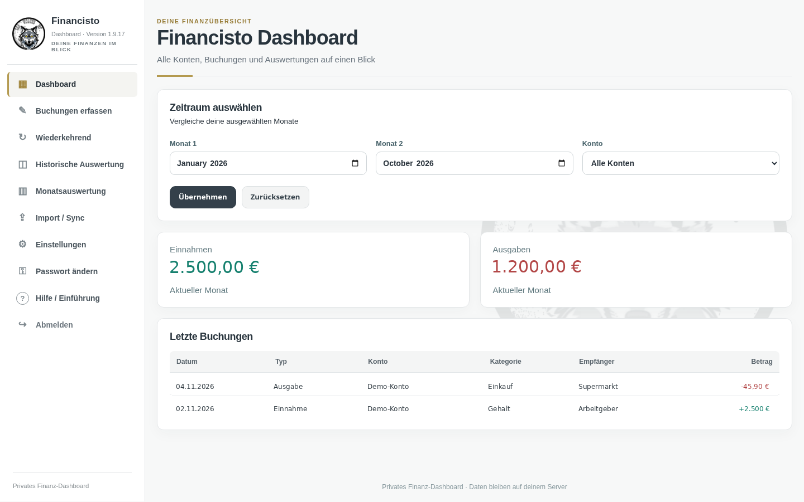
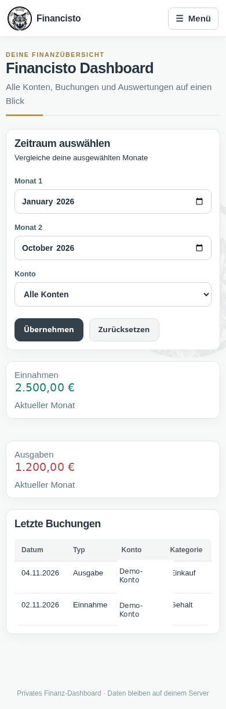
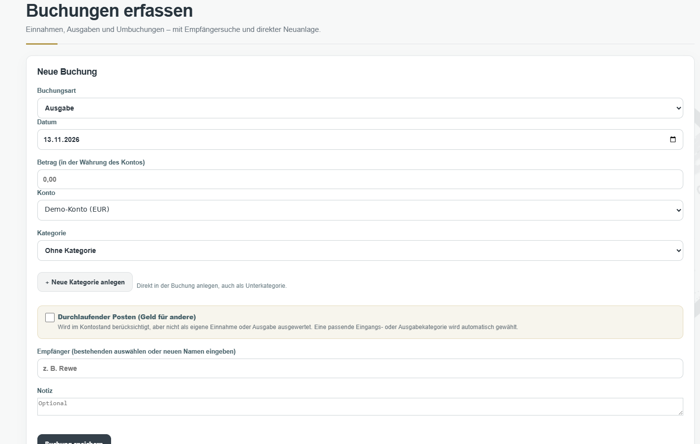

# Financisto-Dashboard (FieLanzen)

**Sprache / Language:** [English (default)](README.md) | **Deutsch**

<p align="center">
  
</p>

<p align="center">
  
</p>


**Deutschsprachiges, selbst gehostetes Finanzdashboard für Docker** – mit Finanzberichten, Buchungsverwaltung, wiederkehrenden Buchungen, PWA und sicherem Import von [Financisto](https://github.com/dsolonenko/financisto)-Backups.

**Aktueller Quellstand:** v1.9.42 · 16. November 2026 (aktualisierte zweisprachige Einführung für neue Benutzer).

## Funktionen

- Konten, Buchungen, Umbuchungen, Empfänger und Kategorien verwalten; Rollen und Zwei-Faktor-Authentifizierung
- Monatsberichte, Haushaltsauswertung, Kontostände, historische Vergleiche und Druckansichten
- **Manueller Financisto-`.backup`-Import bleibt erhalten**; optional automatischer Import per SFTP/FolderSync, in der Weboberfläche steuerbar
- Finanzverwaltung mit wahlweise **Financisto oder der Weboberfläche als führendem System**; Schutz vor unbeabsichtigtem Überschreiben eigener Buchungen
- Wiederkehrende Buchungen mit optionalem Enddatum oder maximaler Anzahl an Ausführungen; Benachrichtigungen über Web Push, Gotify oder Telegram
- Zukünftig datierte Buchungen werden bis zum Buchungsdatum gelb hervorgehoben (nur Anzeige, kein Aufschub der Kontostandsänderung)
- Responsive Oberfläche für PC, Tablet und Smartphone mit installierbarer PWA
- Docker Compose, lokale HTTPS-Konfiguration und Backup-/Update-Skripte; persistente Daten in Bind-Mounts

## Interaktive Einführung für neue Benutzer

Neue Benutzer erhalten nach der Kontoeinrichtung eine **rollenabhängige Einführung auf Deutsch oder Englisch**. Erklärt werden aktuelle Funktionen einschließlich zukünftiger Buchungen, Wiederholungslimits, Datenführung und Sprachwechsel. Bestehende Benutzer werden nicht erneut automatisch durch den Rundgang geführt. Über **Hilfe / Einführung** kann jeder ihn jederzeit neu starten. [Anleitung auf Deutsch](package/docs/ONBOARDING.de.md) · [English](package/docs/ONBOARDING.en.md).

## Ursprung und Abgrenzung

Dieses Dashboard ist eine **eigenständige Webanwendung** und **keine offizielle Version, Weiterentwicklung oder ein Fork** der Android-App Financisto. Es ist durch deren Nutzungs- und Datenmodell inspiriert und unterstützt das Importformat ihrer Sicherungsdateien sowie das Format des verbreiteten Android-Forks.

- **Originalprojekt:** [Financisto – dsolonenko/financisto](https://github.com/dsolonenko/financisto), entwickelt von Denis Solonenko und Mitwirkenden.
- **Unterstützter Android-Fork:** [Financisto Holo – tiberiusteng/financisto1-holo](https://github.com/tiberiusteng/financisto1-holo).

Die Rechte an Financisto und dessen Kennzeichen verbleiben bei den jeweiligen Rechteinhabern. Für Android-App, deren Funktionsweise oder ihre Weiterentwicklung ist dieses Repository nicht zuständig.

## Screenshots

Die folgenden Bilder zeigen die **tatsächliche Gestaltung der Weboberfläche**, allerdings teilweise aus früheren Entwicklungsständen. Kontonamen, Beträge und weitere Angaben wurden durch **Demodaten** ersetzt. Die Desktop-/Mobilansichten stammen aus v1.9.17; einzelne Elemente der aktuellen v1.9.40 können abweichen.

### Dashboard am Desktop



### Mobile Ansicht



### Buchungen erfassen



## Deutsch und Englisch in der Weboberfläche

Die Oberfläche lässt sich jetzt über **DE / EN** jederzeit zwischen Deutsch und Englisch umschalten – bereits bei der Anmeldung, auf dem Smartphone im Kopfbereich und am Desktop in der Seitenleiste. Der Wechsel erfordert **keine neue Anmeldung**. Die Auswahl gilt für die jeweilige Sitzung und wird nicht dauerhaft in den Finanzdaten oder Benutzerprofilen gespeichert. Nach dem Abmelden beziehungsweise Ablauf der Sitzung gilt wieder die Installationsvorgabe.

Bei der **Neuinstallation fragt der Installer zuerst zweisprachig nach Deutsch oder Englisch** und führt die restliche Installation in dieser Sprache durch. Die Wahl wird als `DEFAULT_LANGUAGE=de` oder `DEFAULT_LANGUAGE=en` in der lokalen `.env` gespeichert. Bestehende Installationen bleiben standardmäßig deutsch, sofern der Administrator die Vorgabe nicht ausdrücklich ändert. Die Sprache kann trotzdem jederzeit über DE / EN gewechselt werden.

Alle Übersetzungen befinden sich lokal im Programm; es werden keine Finanzdaten an Übersetzungsdienste gesendet. Vereinzelte ältere Spezial- oder Diagnosemeldungen können noch deutsch erscheinen. [Sprachkonfiguration (Deutsch)](package/docs/LANGUAGE.de.md) · [English](package/docs/LANGUAGE.en.md).

## Caddy und HTTPS

**Caddy ist im Docker-Compose-Projekt bereits enthalten** und übernimmt internes HTTPS sowie die Weiterleitung zum Dashboard. Die mit `tls internal` erzeugte lokale Caddy-Zertifizierungsstelle und die Zertifikate liegen persistent in `caddy/data/`; beim Update bleiben sie erhalten. Wird zusätzlich Nginx Proxy Manager verwendet, benötigt dieser für externe Browser ein eigenes öffentlich vertrauenswürdiges HTTPS-Zertifikat.

**Ausführliche Anleitung:** [Caddy, HTTPS und Nginx Proxy Manager auf Deutsch](package/docs/CADDY.de.md) · [English](package/docs/CADDY.en.md).

**Update-Hinweis:** Von v1.9.35 kann direkt auf v1.9.40 aktualisiert werden; eine Zwischeninstallation ist nicht notwendig. Das Skript sichert vorab Programmcode und SQLite-Datenbank.

## Repository-Struktur

| Pfad | Inhalt |
| --- | --- |
| `package/` | Anwendungsquellcode, Docker-Dateien, `install.sh`, Oberfläche und Dokumentation |
| `update.sh` | Update vorhandener Installationen einschließlich Sicherung |
| `setup_financisto_sftp.sh` | Optionale Einrichtung für den SFTP-Import |
| `README.txt` | Versionshinweise zum Release |
| `package/CHANGELOG.md` | Versionshistorie |
| `package/docs/` | Ausführliche Funktions- und Betriebsdokumentation |

## Neuinstallation

Repository klonen oder als ZIP herunterladen. Im ausgepackten Verzeichnis:

```bash
cd package
./install.sh
```

Das Skript ist als regulärer Linux-Projektbenutzer **ohne sudo** auszuführen. Weitere Hinweise stehen in [package/README.md](package/README.md).

## Bestehende Installation aktualisieren

Quellcode **getrennt von der produktiven Installation** auschecken und im Repository-Hauptverzeichnis als Eigentümer der vorhandenen Installation ausführen:

```bash
./update.sh /pfad/zur/bestehenden/financisto-dashboard-installation
```

**Nicht** die vorhandenen Daten- und Konfigurationsverzeichnisse überschreiben. Das Update-Skript ist für die Datensicherung und die Übernahme der Programmdateien zuständig. Hinweise: [Backup & Restore](package/docs/BACKUP_RESTORE.md).

## Datenschutz und Sicherheit

Produktive SQLite-Datenbanken, Finanztransaktionen, Backups, Passwörter, private Schlüssel, Tokens, befüllte `.env`-Dateien und andere Laufzeitdaten gehören **nicht** in Git. Die Regeln in [`.gitignore`](.gitignore) schließen diese typischen Dateien aus. Vor jeder Veröffentlichung von Quellcode oder Releases muss der Inhalt dennoch kontrolliert werden.

## Lizenz

Dieses Dashboard wird unter der **GNU General Public License, Version 2 (GPL-2.0-only)** angeboten. Die Lizenzbedingungen stehen in [LICENSE](LICENSE); Hinweise zu Projektzuordnung und Drittrechten in [NOTICE.md](NOTICE.md).

Bei Verteilung der Software dürfen Empfänger ihre Kopie gemäß GPL v2 verwenden, verändern und weitergeben. Daraus entsteht **kein Schreibzugriff** auf dieses GitHub-Repository; den verwaltet ausschließlich dessen Eigentümer.

Das ursprüngliche Android-Projekt Financisto steht ebenfalls unter GPL v2. Die Lizenzierung dieses Dashboards begründet weder eine offizielle Zugehörigkeit noch eine Freigabe fremder Marken oder Grafiken.

## Downloads und Releases

Über **Code → Download ZIP** lässt sich der aktuelle Quellstand herunterladen. Zusätzlich können versionierte ZIP-Pakete als **GitHub Releases** veröffentlicht werden.

**Automatische Veröffentlichung:** Der Workflow [Release erstellen](.github/workflows/release.yml) erstellt beim ersten Durchlauf sowie bei neuen Versionsständen in `package/VERSION` einen vollständigen Release-ZIP-Download mit SHA256-Prüfsumme. Bereits veröffentlichte Versionen bleiben unverändert. Alternativ kann der Workflow unter **Actions → Build and publish Financisto Dashboard release → Run workflow** manuell gestartet werden.

Alle fertigen Versionen stehen öffentlich unter [GitHub Releases](https://github.com/renfie/financisto-dashboard/releases). Das Repository ist öffentlich; Bearbeitungsrechte erhält dadurch niemand automatisch.
