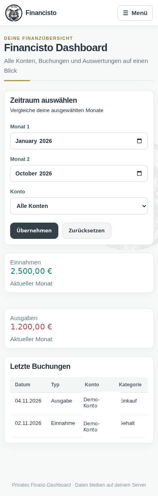

# Financisto Dashboard (FieLanzen)

**Language / Sprache:** **English** | [Deutsch](README.de.md)

<p align="center">
  
</p>

<p align="center">
  
</p>

**An independent, self-hosted personal-finance dashboard for Docker**, featuring transaction management, financial reporting, recurring transactions, an installable PWA, and import/export compatibility with [Financisto](https://github.com/dsolonenko/financisto) backups.

**Current release:** [v1.9.37](https://github.com/renfie/financisto-dashboard/releases) · November 15, 2026. This maintenance release improves public-release privacy and documentation; it does not introduce changes to financial records or accounting logic.

## Features

- Manage accounts, transactions, transfers, payees, and categories with user roles and two-factor authentication
- Monthly reports, household spending summaries, account balances, historical comparisons, and printable reports
- **Manual `.backup` import remains available**; optional SFTP/FolderSync auto-import can be enabled and disabled in the web interface
- Choose **Financisto or the web dashboard as the source of truth**, with safeguards against accidentally overwriting web-created transactions
- Recurring transactions and transfers; Web Push, Gotify and Telegram notifications
- Responsive layouts for desktop, tablet and smartphone, plus an installable Progressive Web App (PWA)
- Docker Compose deployment, local HTTPS, backup/update scripts, and persistent bind-mounted data

## Relationship to Financisto

This project is a **standalone web application**. It is **not an official release, fork, or continuation** of the Financisto Android app. It supports the backup data format used by Financisto and an Android fork but does not claim affiliation with their authors.

- **Original Financisto project:** [dsolonenko/financisto](https://github.com/dsolonenko/financisto), by Denis Solonenko and contributors
- **Compatible Android fork:** [Financisto Holo (tiberiusteng/financisto1-holo)](https://github.com/tiberiusteng/financisto1-holo)

All rights in third-party projects and names remain with their respective owners.

## Screenshots

These screenshots show **real dashboard layouts with example data substituted for private account names and amounts**. Desktop and mobile images were captured from an earlier development version (v1.9.17); some UI elements may differ in v1.9.37.

### Desktop dashboard


### Mobile dashboard



### Enter a transaction


## Repository layout

| Location | Purpose |
| --- | --- |
| `package/` | Application sources, Docker Compose files, `install.sh`, templates, assets and product documentation |
| `update.sh` | Update an existing installation, including backup and validation |
| `setup_financisto_sftp.sh` | Optional setup of a dedicated SFTP import account |
| `README.txt` | Brief release notes in German |
| `package/CHANGELOG.md` | Detailed German version history |
| `package/CHANGELOG.en.md` | English release notes for recent versions |
| `package/README.md` | Detailed setup and operation guide (German) |
| `package/README.en.md` | English setup and operation guide |
| `package/docs/` | Additional technical guides (currently primarily in German) |

## Installation

Clone the repository or download its source ZIP. From the checkout root, run the installation script as the regular Linux project user, **not as root**:

```bash
cd package
./install.sh
```

The script guides you through initial configuration. See the [English installation and operations guide](package/README.en.md) or the [German original](package/README.md). Do **not** run the installer over an existing deployment.

## Updating an existing installation

Check out the new version **in a separate directory**. Run the update script as the Linux account that owns the existing installation:

```bash
./update.sh /path/to/existing/financisto-dashboard
```

The update script validates the layout and access rights and backs up the existing database and program files. It preserves configured domains in `.env`, existing secrets, and bind-mounted financial data. Do not copy release files indiscriminately over the production data directories.

For additional details see the [English operations guide](package/README.en.md) and [backup/restore documentation](package/docs/BACKUP_RESTORE.md) (German).

## Privacy and security

**Never commit or publish** production SQLite databases, `.backup` files containing financial information, filled-in `.env` configurations, passwords, keys, tokens or other runtime secrets. The repository [`.gitignore`](.gitignore) excludes typical sensitive files, but every public release still requires an explicit privacy check. Example domains and IP addresses use documentation-only placeholders rather than private deployment details.

## License

Own dashboard components are distributed under the **GNU General Public License version 2 (GPL-2.0-only)**; see [LICENSE](LICENSE) and [NOTICE.md](NOTICE.md). Recipients may modify and redistribute their own copies subject to the GPL, but this **does not grant write permission** to this repository. The original Financisto Android app is also licensed under GPL v2; compatibility does not imply endorsement or transfer of third-party branding rights.

## Downloads and versioned releases

[**Download the latest release**](https://github.com/renfie/financisto-dashboard/releases/latest) or browse the [release history](https://github.com/renfie/financisto-dashboard/releases). Each release includes a complete Docker installation/update ZIP archive and its SHA256 checksum.

A GitHub Actions [release workflow](.github/workflows/release.yml) creates a new versioned release when `package/VERSION` changes on `main`. Publishing is **not automatic when we discuss or edit code in ChatGPT**; source changes first need to be committed to GitHub and the version needs to be updated. Release notes are available in both English and German.

The repository and downloadable releases are public. Only authorized collaborators can modify the official repository.
