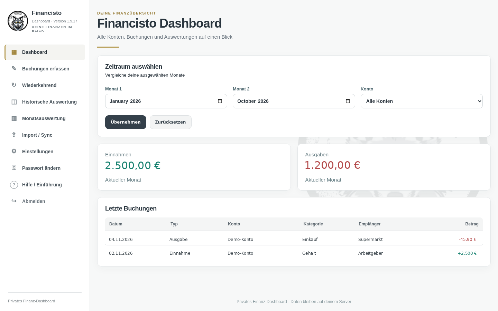

## New in v1.9.56

Category text is now selected on tap for immediate replacement. All application Docker image tags match v1.9.56, and update/release checks prevent future version mismatches.

## Neu in v1.9.54

Filter durchgehend sichtbar; 4 Sekunden Tipp-Pause; wiederkehrende Buchungen markiert; Empfänger in wiederkehrenden Regeln frei eingebbar.

## New in v1.9.53

Tapping or focusing the payee field now shows known payees immediately, even before typing. Suggestions are alphabetized and filtered as you type. The shared admin-configurable limit (default 20) and free-text payee entry remain unchanged.

## New in v1.9.52

Set the number of payee/category suggestions in the administrator settings (default 20, allowed 1–100). No new release or restart is needed to change the limit.

# Financisto Dashboard (FieLanzen)

## New in v1.9.51

The transaction form now offers a mobile-safe, searchable category picker matching the payee suggestions. Dashboard quick search waits five seconds after typing stops; pressing Search remains immediate. Existing category IDs and bookings are unaffected.

**v1.9.51:** Android-safe, searchable category picker and five-second dashboard quick search. All stored category IDs and finance data remain unchanged.


**Language / Sprache:** **English** | [Deutsch](README.de.md)

**v1.9.56 — current release (2026-11-17).** This cumulative release includes all locally tested changes since public v1.9.43: improved English translations, a cash-flow chart, quick transaction-period filters, numbered pagination, improved dashboard ordering and collapsible panels, compact desktop row actions, configurable German/English footers, and the final switch-back-to-Financisto translation fix. [Full release history](package/CHANGELOG.en.md).

<p align="center">
  
</p>

<p align="center">
  
</p>

**An independent, self-hosted personal-finance dashboard for Docker**, featuring transaction management, financial reporting, recurring transactions, an installable PWA, and import/export compatibility with [Financisto](https://github.com/dsolonenko/financisto) backups.

**Latest public release:** v1.9.56 · November 17, 2026. [Download ZIP and checksum](https://github.com/renfie/financisto-dashboard/releases/tag/v1.9.56).


### Version 1.9.46 — Cash flow, period presets and compact controls

[Cash flow and quick periods (English)](package/docs/CASHFLOW.en.md) · [Deutsch](package/docs/CASHFLOW.de.md).

Version 1.9.46 adds independent 1W / 1M / 3M / 6M transaction-list presets, a local cash-flow chart, a collapsible text filter, compact transaction actions and additional English text fixes. Transfers and internal balance adjustments are not counted in cash flow.

### Version 1.9.43 — Login translations and dashboard controls

The 2FA verification and setup texts, recovery-code page and password-change page now appear fully in English when EN is selected. Dashboard quick-action buttons return to a horizontal arrangement on desktop and tablet, while the mobile layout is unchanged. Existing private data and settings are preserved during upgrades.

## Features

- Manage accounts, transactions, transfers, payees, and categories with user roles and two-factor authentication
- Monthly reports, household spending summaries, account balances, historical comparisons, and printable reports
- **Manual `.backup` import remains available**; optional SFTP/FolderSync auto-import can be enabled and disabled in the web interface
- Choose **Financisto or the web dashboard as the source of truth**, with safeguards against accidentally overwriting web-created transactions
- Recurring transactions and transfers with optional end date or maximum number of runs; Web Push, Gotify and Telegram notifications
- Future-dated transactions appear in yellow until their date is reached (display only; posting and balance calculations remain unchanged)
- Responsive layouts for desktop, tablet and smartphone, plus an installable Progressive Web App (PWA)
- Docker Compose deployment, local HTTPS, backup/update scripts, and persistent bind-mounted data

## Guided introduction

New users receive a **role-aware, bilingual introduction** after setting up their account. The tour explains reports, filters, balances, future-dated transactions, bookings, recurring limits, imports and the language selector. Existing users are not forced to repeat it; anyone can restart it from **Help / introduction**. See [English](package/docs/ONBOARDING.en.md) or [Deutsch](package/docs/ONBOARDING.de.md).

## Relationship to Financisto

This project is a **standalone web application**. It is **not an official release, fork, or continuation** of the Financisto Android app. It supports the backup data format used by Financisto and an Android fork but does not claim affiliation with their authors.

- **Original Financisto project:** [dsolonenko/financisto](https://github.com/dsolonenko/financisto), by Denis Solonenko and contributors
- **Compatible Android fork:** [Financisto Holo (tiberiusteng/financisto1-holo)](https://github.com/tiberiusteng/financisto1-holo)

All rights in third-party projects and names remain with their respective owners.

## Screenshots

These screenshots show **real dashboard layouts with example data substituted for private account names and amounts**. Desktop and mobile images were captured from an earlier development version (v1.9.17); some UI elements may differ in v1.9.40.

### Desktop dashboard



### Mobile dashboard


### Enter a transaction


## Languages: English and German

The web interface supports **German (DE) and English (EN)**. Use the **DE / EN switch** on the sign-in screen, mobile header or desktop sidebar. Switching applies immediately after reloading the current page and **does not require a new login**. The selection is stored in the browser's protected application session, not in financial database tables or in permanent user profile records; it resets to the installation default after logout or session expiry.

The **first-time installer is bilingual**: its first prompt asks for **Deutsch / English**, and subsequent setup prompts are displayed in the chosen language. This choice sets `DEFAULT_LANGUAGE=de` or `DEFAULT_LANGUAGE=en` in the newly created `.env`. On an existing installation, `DEFAULT_LANGUAGE` is optional and defaults to German; every user can still switch in the web UI.

Translations are bundled locally; no third-party translation service receives financial data. A few specialized or legacy diagnostic messages may still be shown in German. See [language configuration (English)](package/docs/LANGUAGE.en.md) or [Deutsch](package/docs/LANGUAGE.de.md).

## Built-in Caddy HTTPS reverse proxy

Caddy is **included as a separate Docker Compose service**, handling internal HTTPS and proxying authorized requests to the dashboard. It uses an **internal Caddy CA** (`tls internal`) for LAN and upstream TLS; publicly trusted certificates must be configured separately at an optional Nginx Proxy Manager. Caddy's CA keys, certificates and configuration are persistent bind-mounted data, retained when updating.

**Full guide:** [Caddy / HTTPS / Nginx Proxy Manager (English)](package/docs/CADDY.en.md) · [Deutsch](package/docs/CADDY.de.md).

## Repository layout

| Location | Purpose |
| --- | --- |
| `package/` | Application sources, Docker Compose files, `install.sh`, templates, assets and product documentation |
| `update.sh` | Update an existing installation, including backup and validation |
| `setup_financisto_sftp.sh` | Optional setup of a dedicated SFTP import account |
| `README.txt` | Brief release notes in German |
| `package/CHANGELOG.md` | Detailed German version history |
| `package/CHANGELOG.en.md` | English release notes for recent versions |
| `package/README.md` | Detailed setup and operation guide (German) |
| `package/README.en.md` | English setup and operation guide |
| `package/docs/` | Additional technical guides (currently primarily in German) |

## Installation

Clone the repository or download its source ZIP. From the checkout root, run the installation script as the regular Linux project user, **not as root**:

```bash
cd package
./install.sh
```

The script guides you through initial configuration. See the [English installation and operations guide](package/README.en.md) or the [German original](package/README.md). Do **not** run the installer over an existing deployment.

## Updating an existing installation

Check out the new version **in a separate directory**. Run the update script as the Linux account that owns the existing installation:

```bash
./update.sh /path/to/existing/financisto-dashboard
```

Updates can be applied **directly from v1.9.35 to v1.9.40**; no intermediate v1.9.36/v1.9.37 update is necessary. The update script validates the layout and access rights and backs up the existing database and program files. It preserves configured domains in `.env`, existing secrets, and bind-mounted financial data. Do not copy release files indiscriminately over the production data directories.

For additional details see the [English operations guide](package/README.en.md) and [backup/restore documentation](package/docs/BACKUP_RESTORE.md) (German).

## Privacy and security

**Never commit or publish** production SQLite databases, `.backup` files containing financial information, filled-in `.env` configurations, passwords, keys, tokens or other runtime secrets. The repository [`.gitignore`](.gitignore) excludes typical sensitive files, but every public release still requires an explicit privacy check. Example domains and IP addresses use documentation-only placeholders rather than private deployment details.

## License

Own dashboard components are distributed under the **GNU General Public License version 2 (GPL-2.0-only)**; see [LICENSE](LICENSE) and [NOTICE.md](NOTICE.md). Recipients may modify and redistribute their own copies subject to the GPL, but this **does not grant write permission** to this repository. The original Financisto Android app is also licensed under GPL v2; compatibility does not imply endorsement or transfer of third-party branding rights.

## Downloads and versioned releases

[**Download the latest release**](https://github.com/renfie/financisto-dashboard/releases/latest) or browse the [release history](https://github.com/renfie/financisto-dashboard/releases). Each release includes a complete Docker installation/update ZIP archive and its SHA256 checksum.

A GitHub Actions [release workflow](.github/workflows/release.yml) creates a new versioned release when `package/VERSION` changes on `main`. Publishing is **not automatic when we discuss or edit code in ChatGPT**; source changes first need to be committed to GitHub and the version needs to be updated. Release notes are available in both English and German.

The repository and downloadable releases are public. Only authorized collaborators can modify the official repository.


### Local test v1.9.48 / Lokaler Teststand

Footer: APP_FOOTER="Deutscher Text" and APP_FOOTER_EN="English text" in the existing .env. If APP_FOOTER_EN is empty, known built-in slogans are translated; other custom strings are retained as entered.
